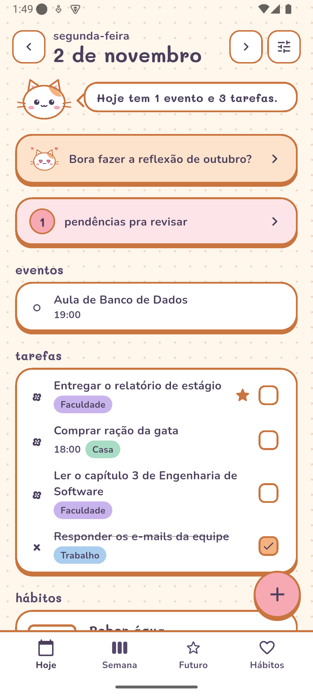
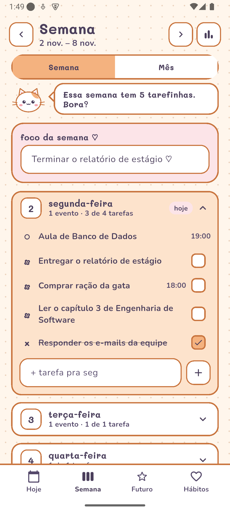
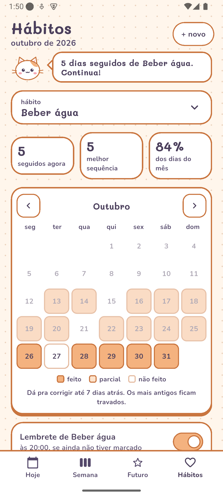
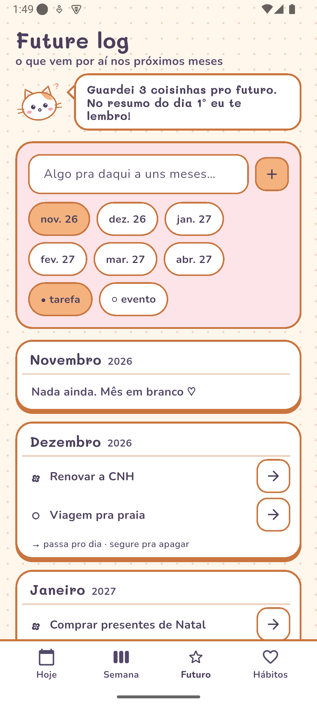

# Meu Bujo 🐱

**Meu Bujo** quer dizer **Meu Bullet Journal** ("bujo" é o apelido que a comunidade de bullet journal usa para o caderno).

Um bullet journal fofo para Android, com uma gatinha que reage ao que você faz. Feito em **Flutter**.

Tarefas, eventos e hábitos num lugar só, no estilo do bullet journal (`•` tarefa, `○` evento, `×` feita, `>` migrada), com backup no Google Drive, sincronização com o Google Agenda e widgets na tela inicial e na tela de bloqueio.

<p align="center">
  
  
  
  
</p>

<sub>Prints feitos com dados de exemplo (modo demonstração).</sub>

## O que o app faz

| Área | O que tem |
|---|---|
| **Hoje** | Daily log com eventos, tarefas (prioritárias primeiro) e hábitos; copo d'água que enche; navegar entre dias |
| **Pendências** | Tarefas atrasadas para migrar; aviso a partir da 3ª migração; nunca migra sozinho |
| **Semana e Mês** | Foco da semana, dias que abrem e fecham, calendário do mês com metas |
| **Future log** | Coisas para os próximos meses, que depois passam para um dia |
| **Hábitos** | Todo dia, dias da semana ou X vezes por semana; feito/não feito ou meta (ex.: 2 L de água); sequência, % do mês e lembrete |
| **Coleções** | Mestrado, Trabalho, Casa…, cada uma com cor e progresso |
| **Estatísticas** | Feitas, migradas e canceladas por semana ou mês, por coleção |
| **Reflexão mensal** | Como foi o mês e o que fica para o próximo (vira meta) |
| **Google** | Login, backup automático no Drive (pasta escondida do app) e Google Agenda nos dois sentidos, inclusive com o app fechado. As tarefas ficam numa agenda própria, "Bujo – Tarefas" (dia inteiro; feita = título com "✓ "), então qualquer ferramenta que lê o Google Agenda consegue ver e criar tarefas |
| **Avisos** | Lembrete no horário de cada item e resumo do dia de manhã |
| **Widgets** | Água, água e tarefas, "meu dia" e uma faixa para a tela de bloqueio |
| **Visual** | 5 paletas pastel, tema claro e escuro, gatinha com 6 humores desenhada em código |

## Como foi feito

O projeto começou por um **levantamento de casos de uso** antes de qualquer tela: atores, 25 casos de uso priorizados em Must, Should e Could, e 33 regras de negócio. Está tudo em [casos-de-uso-bullet-journal.md](casos-de-uso-bullet-journal.md). Depois vieram o protótipo navegável e, por último, o app. As regras aparecem no código com o mesmo número do documento (por exemplo, `// RN12: nunca pro passado`).

**Tecnologias:** Flutter e Dart, `provider`, `shared_preferences`, `google_sign_in` e `googleapis` (Drive e Calendar), `flutter_local_notifications`, `workmanager` (sincronização em segundo plano), `home_widget` (widgets em Kotlin e XML).

```
lib/
  main.dart             abre o app, tema e idioma pt-BR
  tema.dart             paletas pastel, cores e fontes (Mali + Nunito)
  dados/
    modelos.dart        Tarefa, Evento, Hábito, Coleção, Reflexão
    estado.dart         regras do app e salvamento no celular
    nuvem.dart          login com Google e backup no Drive
    agenda.dart         conversa com o Google Agenda
    segundo_plano.dart  sincronização com o app fechado
    estatisticas.dart   números de tarefas por período
    notificacoes.dart   avisos, resumo do dia e lembretes
    widget_casa.dart    dados dos widgets da tela inicial
  widgets/              gatinha, cartões, botões, copo d'água
  telas/                uma tela por arquivo
android/.../BujoWidget.kt  os widgets nativos
test/                   testes das regras de negócio
tool/                   gera o ícone a partir do desenho da gatinha
```

## Rodar o projeto

Precisa do [Flutter](https://docs.flutter.dev/get-started/install) e de um celular ou emulador Android.

1. Copie o arquivo de configuração do Google:

   ```bash
   cp lib/config_google.exemplo.dart lib/config_google.dart
   ```

2. Rode:

   ```bash
   flutter pub get
   ```

   ```bash
   flutter test
   ```

   ```bash
   flutter run
   ```

Sem configurar o Google, o app funciona normalmente com os dados só no celular ("Continuar sem conta").

### Login com Google, Drive e Agenda (opcional)

Precisa de um projeto seu no [Google Cloud](https://console.cloud.google.com):

1. Crie um projeto e ative a **Google Drive API** e a **Google Calendar API**.
2. Em **Google Auth Platform**, configure a tela de permissão (público **Externo**) e adicione o seu e-mail em **Usuários de teste**.
3. Crie um cliente **Android** com o pacote `com.meubujo.meu_bujo` e o SHA-1 da sua chave de depuração. Para ver o SHA-1:

   ```bash
   keytool -list -v -keystore ~/.android/debug.keystore -alias androiddebugkey -storepass android -keypass android
   ```

4. Crie um cliente **Aplicativo da Web** e cole o **ID do cliente** em `lib/config_google.dart`. A chave secreta do cliente não é usada e não deve ir para o código.

O `lib/config_google.dart` fica fora do git, então o seu ID não vai para o repositório.

### Modo demonstração

Para ver o app já cheio de dados de exemplo (foi assim que os prints foram feitos), rode com:

```bash
flutter run --dart-define=DEMO=true
```

Com a variável de ambiente `MEUBUJO_DEMO=1`, o build instala como um app separado (`com.meubujo.meu_bujo.demo`), sem misturar com os seus dados.

### Ícone

O ícone é a própria gatinha do app. Para gerar de novo:

```bash
flutter test tool/gerar_icone_test.dart
```

```bash
dart run flutter_launcher_icons
```
