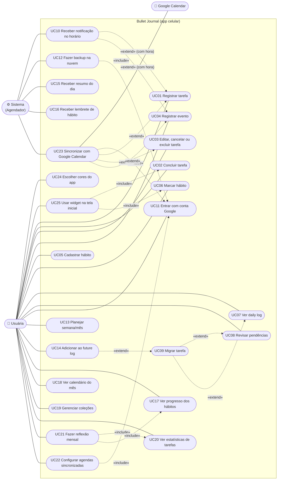

# Bullet Journal Digital: Casos de Uso

Levantamento feito em 28/10/2026, com respostas no papel de usuária final.

**Problema:** hoje as tarefas, eventos e hábitos ficam espalhados entre planilha, caderno e WhatsApp. Isso gera trabalho manual, esquecimentos e falta de visão geral.
**Plataforma:** app para celular, uso individual, com entrada manual dos dados (sem importação).

---

## 1. Atores

| Ator | Descrição |
|---|---|
| **Usuária** | Única pessoa que usa o app. Registra, organiza e acompanha tarefas, eventos e hábitos. |
| **Sistema (Agendador)** | Ator secundário, interno ao app. Dispara notificações, calcula pendências, faz o backup na nuvem e roda a sincronização. |
| **Google Calendar** | Sistema externo. Guarda as agendas da conta Google da Usuária e troca eventos e tarefas com o app nos dois sentidos. |

---

## 2. Tabela de casos de uso

| ID | Caso de uso | Ator principal | Prioridade |
|---|---|---|---|
| UC01 | Registrar tarefa | Usuária | Must |
| UC02 | Concluir tarefa | Usuária | Must |
| UC03 | Editar, cancelar ou excluir tarefa | Usuária | Must |
| UC04 | Registrar evento | Usuária | Must |
| UC05 | Cadastrar hábito | Usuária | Must |
| UC06 | Marcar hábito | Usuária | Must |
| UC07 | Ver daily log | Usuária | Must |
| UC08 | Revisar pendências | Usuária | Must |
| UC09 | Migrar tarefa | Usuária | Must |
| UC10 | Receber notificação no horário | Sistema | Must |
| UC11 | Entrar com conta Google | Usuária | Must |
| UC12 | Fazer backup na nuvem | Sistema | Must |
| UC22 | Configurar agendas sincronizadas | Usuária | Must |
| UC23 | Sincronizar com Google Calendar | Sistema / Google Calendar | Must |
| UC24 | Escolher cores do app (paleta pastel) | Usuária | Should |
| UC25 | Usar widget na tela inicial | Usuária | Should |
| UC13 | Planejar semana/mês | Usuária | Should |
| UC14 | Adicionar ao future log | Usuária | Should |
| UC15 | Receber resumo do dia | Sistema | Should |
| UC16 | Receber lembrete de hábito | Sistema | Should |
| UC17 | Ver progresso dos hábitos | Usuária | Should |
| UC18 | Ver calendário do mês | Usuária | Should |
| UC19 | Gerenciar coleções | Usuária | Could |
| UC20 | Ver estatísticas de tarefas | Usuária | Could |
| UC21 | Fazer reflexão mensal | Usuária | Could |

**Won't (por agora):** notas soltas, importar planilha, compartilhar com outras pessoas, versão para computador.

---

## 3. Diagrama de casos de uso

> Mermaid não tem um tipo nativo de diagrama de casos de uso. Por isso o diagrama usa um `flowchart`: os atores ficam à esquerda, a fronteira do sistema é o `subgraph` e «include»/«extend» são as setas pontilhadas.

---

## 4. Especificação dos casos Must

### UC01: Registrar tarefa
- **Ator:** Usuária
- **Pré-condições:** o app está aberto.
- **Fluxo principal:**
  1. A Usuária escolhe adicionar uma tarefa.
  2. O app mostra o formulário com a data de hoje já preenchida.
  3. A Usuária digita o texto da tarefa.
  4. A Usuária pode preencher hora, prioridade, coleção e subtarefas (todos opcionais).
  5. A Usuária salva.
  6. O app grava a tarefa com status *aberta* e a mostra no daily log da data escolhida.
- **Fluxos alternativos:**
  - **A1. Hora informada (passo 4):** a Usuária escolhe a antecedência do aviso (padrão: na hora), e o app agenda a notificação (UC10).
  - **A2. Data futura (passo 4):** a tarefa aparece no daily log daquela data.
  - **A3. Subtarefas (passo 4):** a Usuária adiciona itens de checklist dentro da tarefa. Eles não têm data nem hora próprias.
- **Fluxos de exceção:**
  - **E1. Texto vazio (passo 5):** o app não salva e pede o texto.
  - **E2. Notificações bloqueadas no celular (A1):** o app salva a tarefa e avisa que não vai conseguir lembrar no horário.
- **Pós-condições:** a tarefa fica salva como *aberta* na data definida.
- **Regras de negócio:** RN01, RN02, RN03.

### UC02: Concluir tarefa
- **Ator:** Usuária
- **Pré-condições:** existe uma tarefa *aberta*.
- **Fluxo principal:**
  1. A Usuária marca a tarefa como feita.
  2. O app muda o status para *concluída*, registra a data de conclusão e a mostra marcada (×).
  3. Se havia notificação agendada, o app a cancela.
- **Fluxos alternativos:**
  - **A1. Tarefa com subtarefas:** concluir a tarefa marca todas as subtarefas. Já marcar todas as subtarefas não conclui a tarefa automaticamente.
  - **A2. Desfazer:** a Usuária desmarca e a tarefa volta a ficar *aberta*.
- **Pós-condições:** a tarefa fica *concluída* e deixa de contar como pendência.
- **Regras de negócio:** RN04.

### UC03: Editar, cancelar ou excluir tarefa
- **Ator:** Usuária
- **Pré-condições:** existe uma tarefa.
- **Fluxo principal (editar):**
  1. A Usuária abre a tarefa.
  2. A Usuária altera o texto, a data, a hora, a prioridade, a coleção ou as subtarefas.
  3. A Usuária salva e o app atualiza a tarefa e reagenda a notificação, se houver.
- **Fluxos alternativos:**
  - **A1. Cancelar:** a Usuária escolhe cancelar. O status muda para *cancelada*, a tarefa aparece riscada e não conta como pendência.
  - **A2. Excluir:** a Usuária escolhe excluir. O app pede confirmação e remove a tarefa. Se ela estiver sincronizada, o app pergunta se exclui também do Google (UC23 A2).
  - **A3. Reabrir cancelada:** a tarefa volta a ficar *aberta*.
- **Fluxos de exceção:**
  - **E1. Texto apagado na edição:** o app não salva.
- **Pós-condições:** a tarefa fica atualizada, cancelada ou removida.
- **Regras de negócio:** RN01, RN04, RN05.

### UC04: Registrar evento
- **Ator:** Usuária
- **Pré-condições:** o app está aberto.
- **Fluxo principal:**
  1. A Usuária escolhe adicionar um evento.
  2. A Usuária informa o título, a data e a hora (opcional).
  3. A Usuária salva.
  4. O app mostra o evento no daily log da data (marcador ○).
- **Fluxos alternativos:**
  - **A1. Hora informada:** o app agenda a notificação (UC10).
  - **A2. Editar ou excluir evento:** funciona igual ao UC03, mas um evento não tem status de concluído.
  - **A3. Evento vindo do Google:** aparece no daily log como qualquer outro evento e pode ser editado no app (UC23).
- **Fluxos de exceção:**
  - **E1. Título vazio:** o app não salva.
- **Pós-condições:** o evento fica salvo na data.
- **Regras de negócio:** RN02, RN06.

### UC05: Cadastrar hábito
- **Ator:** Usuária
- **Pré-condições:** o app está aberto.
- **Fluxo principal:**
  1. A Usuária escolhe criar um hábito.
  2. A Usuária informa o nome do hábito.
  3. A Usuária escolhe a frequência: todo dia, dias da semana específicos ou X vezes por semana.
  4. A Usuária escolhe o tipo: *feito/não feito* ou *meta com quantidade* (valor e unidade, ex.: 2 L).
  5. A Usuária salva e o hábito passa a aparecer nos dias em que deve ser feito.
- **Fluxos alternativos:**
  - **A1. Editar hábito:** alterar a frequência ou a meta vale daqui para frente. O histórico não muda.
  - **A2. Arquivar hábito:** o hábito some do dia a dia, mas o histórico continua guardado.
- **Fluxos de exceção:**
  - **E1. Nome vazio, nenhum dia escolhido ou meta ≤ 0:** o app não salva.
- **Pós-condições:** o hábito fica ativo com a frequência definida.
- **Regras de negócio:** RN07, RN08.

### UC06: Marcar hábito
- **Ator:** Usuária
- **Pré-condições:** existe um hábito ativo.
- **Fluxo principal:**
  1. A Usuária vê os hábitos do dia.
  2. A Usuária marca o hábito como feito, ou informa a quantidade no caso de meta.
  3. O app registra a marcação no dia e atualiza o progresso.
- **Fluxos alternativos:**
  - **A1. Dia passado:** a Usuária escolhe uma data anterior e marca ou corrige. Não há limite de dias.
  - **A2. Meta parcial:** a quantidade abaixo da meta fica registrada como *parcial*.
  - **A3. Desmarcar:** o app remove a marcação do dia.
- **Pós-condições:** o registro do dia fica salvo e o progresso é atualizado.
- **Regras de negócio:** RN08, RN09.

### UC07: Ver daily log
- **Ator:** Usuária
- **Pré-condições:** o app está aberto.
- **Fluxo principal:**
  1. O app abre no daily log de hoje.
  2. O app mostra os eventos, as tarefas (prioritárias primeiro) e os hábitos do dia.
  3. A partir daqui, a Usuária pode registrar (UC01, UC04), concluir (UC02) ou marcar hábito (UC06).
- **Fluxos alternativos:**
  - **A1. Navegar para outro dia:** a Usuária passa para um dia anterior ou seguinte, ou escolhe uma data.
  - **A2. Pendências existentes:** o app mostra o aviso de pendências e leva à revisão (UC08).
  - **A3. Migrar uma tarefa direto do daily log** (UC09).
- **Pós-condições:** nenhuma alteração de dados.
- **Regras de negócio:** RN03, RN10.

### UC08: Revisar pendências
- **Ator:** Usuária
- **Pré-condições:** existe pelo menos uma tarefa pendente (RN10).
- **Fluxo principal:**
  1. Ao abrir o app, o Sistema calcula todas as pendências acumuladas desde a última revisão, mesmo que sejam de vários dias.
  2. O app avisa: "Você tem N pendências".
  3. A Usuária abre a revisão e vê as pendências agrupadas por data de origem.
  4. Para cada tarefa, a Usuária escolhe migrar (UC09), concluir (UC02) ou cancelar (UC03).
  5. Quando a lista se esvazia, o app registra a data da revisão.
- **Fluxos alternativos:**
  - **A1. Revisar depois:** a Usuária fecha a revisão. As pendências continuam marcadas e o aviso volta na próxima abertura.
  - **A2. Ação em lote:** a Usuária seleciona várias tarefas e move todas para hoje.
- **Pós-condições:** cada pendência tratada sai da lista. O app não migra nada sozinho.
- **Regras de negócio:** RN10, RN11.

### UC09: Migrar tarefa
- **Ator:** Usuária
- **Pré-condições:** existe uma tarefa *aberta*.
- **Fluxo principal:**
  1. A Usuária escolhe migrar a tarefa.
  2. O app oferece *Mover para hoje* ou *Agendar outro dia*.
  3. Se a Usuária escolher *Mover para hoje*, o app muda a data da tarefa para hoje.
  4. A tarefa passa a aparecer no daily log da nova data. Na data original, ela fica marcada como migrada (>).
- **Fluxos alternativos:**
  - **A1. Agendar outro dia (passo 3):** a Usuária escolhe uma data no calendário.
  - **A2. Future log (Should, UC14):** a Usuária escolhe um mês futuro sem dia definido.
  - **A3. Tarefa com hora:** a hora é mantida e a notificação é reagendada.
  - **A4. Terceira migração ou mais:** antes de salvar, o app avisa "Esta tarefa já foi migrada N vezes. Ainda vale a pena?". A Usuária pode confirmar a migração ou cancelar a tarefa (UC03).
- **Fluxos de exceção:**
  - **E1. Data no passado:** o app não aceita.
- **Pós-condições:** a tarefa fica *aberta* na nova data e tem histórico de migração.
- **Regras de negócio:** RN11, RN12.

### UC10: Receber notificação no horário
- **Ator:** Sistema (Agendador). A Usuária é quem recebe.
- **Pré-condições:** existe uma tarefa *aberta* ou um evento com hora, e as notificações estão permitidas no celular.
- **Fluxo principal:**
  1. No horário do item menos a antecedência escolhida, o Sistema dispara a notificação com o título.
  2. A Usuária toca na notificação e o app abre o item.
- **Fluxos alternativos:**
  - **A1. Ação rápida na notificação:** a Usuária toca em "Concluir" (só para tarefas, UC02).
  - **A2. Item concluído, cancelado, excluído ou com horário alterado antes da hora:** o Sistema cancela ou reagenda a notificação.
  - **A3. Item vindo do Google:** o app usa a antecedência que o item tinha no Google e desliga o aviso do próprio Google, para não haver lembrete duplicado.
- **Fluxos de exceção:**
  - **E1. Celular desligado na hora:** o sistema operacional entrega a notificação quando o celular volta, se for possível.
  - **E2. Permissão negada:** nenhuma notificação é enviada, e o app mostra um aviso nas configurações.
- **Pós-condições:** a notificação foi entregue. Nenhum dado muda, a não ser no A1.
- **Regras de negócio:** RN02, RN13.

### UC11: Entrar com conta Google
- **Ator:** Usuária
- **Pré-condições:** o app está instalado e o celular tem internet.
- **Fluxo principal:**
  1. No primeiro uso, o app pede para entrar com a conta Google.
  2. A Usuária escolhe a conta e autoriza o acesso à agenda (tela do próprio Google).
  3. O app cria o perfil, restaura o backup se existir (UC12) e abre a configuração de agendas (UC22).
- **Fluxos alternativos:**
  - **A1. Já existe backup dessa conta (celular novo):** os dados voltam antes de abrir o daily log.
  - **A2. Sair da conta:** o app para de sincronizar. Os dados locais ficam, até a Usuária entrar de novo.
- **Fluxos de exceção:**
  - **E1. Acesso à agenda negado:** o app entra, faz o backup, mas avisa que a sincronização com o Google fica desligada até autorizar.
  - **E2. Sem internet:** o app avisa e pede para tentar de novo.
- **Pós-condições:** a Usuária fica autenticada e o app tem permissão de ler e escrever na agenda.
- **Regras de negócio:** RN14.

### UC12: Fazer backup na nuvem
- **Ator:** Sistema (Agendador)
- **Pré-condições:** a Usuária entrou com a conta Google (UC11).
- **Fluxo principal:**
  1. A cada alteração (ou quando a internet volta), o Sistema envia as mudanças para a nuvem.
  2. O app mostra a hora do último backup nas configurações.
- **Fluxos alternativos:**
  - **A1. Restaurar:** ao entrar num celular novo, o Sistema baixa todos os dados (UC11 A1).
- **Fluxos de exceção:**
  - **E1. Sem internet:** as mudanças ficam guardadas no celular e sobem quando a conexão voltar. O app continua funcionando normalmente.
- **Pós-condições:** os dados na nuvem ficam iguais aos do celular.
- **Regras de negócio:** RN15.

### UC22: Configurar agendas sincronizadas
- **Ator:** Usuária
- **Pré-condições:** a Usuária entrou com a conta Google e autorizou a agenda (UC11).
- **Fluxo principal:**
  1. O app lista as agendas da conta Google (ex.: Pessoal, Fatec, Mestrado).
  2. A Usuária marca quais agendas entram no app.
  3. Para cada agenda marcada, a Usuária escolhe se os itens viram **evento** ou **tarefa** no app.
  4. A Usuária escolhe a **agenda de destino** para o que ela criar no app.
  5. A Usuária salva e o Sistema faz a primeira sincronização (UC23).
- **Fluxos alternativos:**
  - **A1. Mudar depois:** a Usuária volta nas configurações e altera agendas ou tipos. Desmarcar uma agenda tira os itens dela do app, mas não apaga nada no Google.
- **Fluxos de exceção:**
  - **E1. Nenhuma agenda marcada:** o app salva, mas avisa que nada será sincronizado.
- **Pós-condições:** fica definido quais agendas entram, como cada uma vira item no app e para onde vão os itens novos.
- **Regras de negócio:** RN17, RN18.

### UC23: Sincronizar com Google Calendar
- **Ator:** Sistema (Agendador). Ator secundário: Google Calendar.
- **Pré-condições:** agendas configuradas (UC22) e acesso à agenda autorizado.
- **Fluxo principal:**
  1. Quando a Usuária cria ou edita uma tarefa ou evento (UC01, UC03, UC04), o Sistema envia a mudança para a agenda de destino.
  2. Periodicamente, também em segundo plano com o app fechado, o Sistema busca as mudanças das agendas marcadas no Google.
  3. Os itens novos ou alterados no Google aparecem no daily log, como evento ou tarefa conforme a agenda.
- **Fluxos alternativos:**
  - **A1. Mesmo item alterado nos dois lados:** vale a alteração mais recente, sem perguntar.
  - **A2. Item excluído de um lado:** o app pergunta se deve excluir também do outro lado. Se a Usuária disser não, o item é desvinculado e continua só onde está.
  - **A3. Tarefa sem hora:** vai para o Google como item de dia inteiro.
  - **A4. Tarefa migrada (UC09):** a data também muda no Google.
  - **A5. Tarefa concluída ou cancelada (UC02, UC03):** o item continua no Google, mas o título ganha ✓ (concluída) ou ✕ (cancelada) no começo. Se a tarefa for reaberta, a marca sai.
- **Fluxos de exceção:**
  - **E1. Sem internet:** as mudanças ficam na fila e são enviadas quando a conexão voltar.
  - **E2. Acesso revogado no Google:** o Sistema para de sincronizar e o app pede para autorizar de novo.
  - **E3. Agenda apagada no Google:** o app avisa e a remove da lista de agendas sincronizadas.
- **Pós-condições:** os itens das agendas marcadas ficam iguais no app e no Google.
- **Regras de negócio:** RN16 a RN21.

---

## 5. Regras de negócio

| ID | Regra |
|---|---|
| RN01 | Toda tarefa tem texto obrigatório e data obrigatória (padrão: hoje). Hora, prioridade, coleção e subtarefas são opcionais. |
| RN02 | Só itens com hora geram notificação no horário. |
| RN03 | A prioridade é um marcador sim/não (*). As tarefas prioritárias aparecem primeiro no dia. |
| RN04 | Status de tarefa: *aberta*, *concluída*, *cancelada* e *migrada* (esse último só na data de origem). |
| RN05 | Excluir uma tarefa exige confirmação. Cancelar mantém a tarefa visível e riscada. |
| RN06 | Eventos não têm status de conclusão e não viram pendência. |
| RN07 | Frequência de hábito: todo dia, dias da semana específicos ou X vezes por semana. O tipo pode ser feito/não feito ou meta numérica com unidade. |
| RN08 | Alterar a frequência ou a meta de um hábito não muda o histórico já registrado. |
| RN09 | Hábitos podem ser marcados hoje e até 7 dias atrás. Dias mais antigos ficam travados (só mostram o histórico). Não se marca hábito em dia futuro. *(Alterada em 29/10/2026: antes era "sem limite".)* |
| RN10 | Pendência é uma tarefa com status *aberta* e data anterior a hoje. |
| RN11 | O app nunca migra tarefas automaticamente. Ele só avisa, e quem decide é a Usuária. |
| RN12 | Uma migração não pode ter como destino uma data no passado. |
| RN13 | Concluir, cancelar, excluir ou mudar o horário de um item atualiza a notificação agendada. |
| RN14 | O login é feito só com conta Google. A mesma conta serve para o backup e para a agenda. |
| RN15 | O backup é automático. Sem internet, o app funciona normalmente e envia as mudanças quando a conexão voltar. |
| RN16 | A sincronização com o Google Calendar é nos dois sentidos e inclui eventos e todas as tarefas. Hábitos não vão para o Google. |
| RN17 | Só as agendas marcadas pela Usuária entram no app. Cada agenda é definida como "vira evento" ou "vira tarefa". |
| RN18 | Itens criados no app vão para a agenda de destino escolhida pela Usuária. |
| RN19 | Conflito, quando o mesmo item é alterado nos dois lados: vale a alteração mais recente. |
| RN20 | Excluir um item sincronizado sempre pergunta se deve excluir também do outro lado. Se a resposta for não, o item é desvinculado. |
| RN21 | Tarefas sem hora vão para o Google como itens de dia inteiro. |
| RN22 | A antecedência da notificação é escolhida em cada item: na hora, 15 min, 1 h ou 1 dia antes. O padrão é "na hora". |
| RN23 | Só o app envia lembretes. Nos itens sincronizados, o aviso do Google é desligado. |
| RN24 | No Google, tarefa concluída recebe "✓ " no começo do título e cancelada recebe "✕ ". Reabrir a tarefa tira a marca. |
| RN25 | A sincronização roda também em segundo plano, com o app fechado. |
| RN26 | O horário do resumo do dia (UC15) é configurável. O padrão é 7h. |
| RN27 | A semana começa na segunda-feira, tanto para "X vezes por semana" quanto para o planejamento semanal. |
| RN28 | A partir da 3ª migração de uma tarefa, o app pergunta se ela ainda vale a pena antes de migrar. |
| RN29 | Subtarefas são só um checklist, sem data, hora ou notificação próprias. |
| RN30 | Cores do app (UC24): 5 paletas pastel (Pêssego, padrão; Rosa, Lilás, Menta e Céu). A escolha vale para o app inteiro e funciona no tema claro e no escuro. |
| RN31 | Widget (UC25) em 3 tamanhos. **Pequeno:** copo d'água com botão +250 ml. **Médio:** copo e até 3 tarefas abertas de hoje. **Grande:** data, gatinha, até 6 tarefas de hoje (prioritárias primeiro) e barra de água. |
| RN32 | No widget só dá para somar água; não se digita nada. As tarefas aparecem só para ver: marcar como feita é dentro do app. Tocar numa tarefa ou no restante do widget abre o app na tela Hoje. *(Alterada em 29/10/2026: antes o widget também concluía tarefas.)* |
| RN33 | O widget é atualizado sempre que algo muda no app; sem isso, o sistema do celular atualiza no máximo a cada 30 min no Android e conforme a linha do tempo no iPhone. |

---

## 6. Perguntas em aberto

Nenhuma. As 8 perguntas levantadas foram respondidas em 28/10/2026 e viraram as regras RN22 a RN29.
